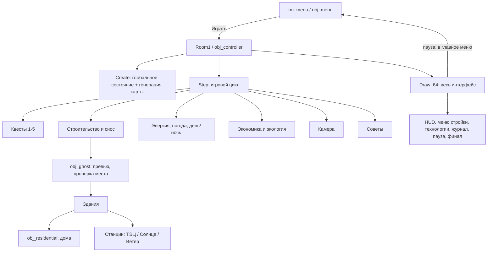

# Инвентарь функционала: первичный анализ

Анализ выполнен по исходному коду проекта (GameMaker, GML), состояние на коммит `6c14132` (v1.1.5).
В список включено только то, что реально присутствует в коде. Отдельно отмечены заглушки и расхождения.

Документ перепроверен повторным построчным разбором всех `.gml`-файлов, `.yyp` и комнат (16.11.2026). Исправлено описание клавиатурной навигации меню (там не «невидимый выбор», а ошибка выполнения), добавлены пропущенные особенности (механика размещения, заморозка симуляции, клик по «!»), уточнены технические параметры и список неиспользуемых ресурсов.

Технические параметры: скорость игры 60 шагов/с; комната `Room1` 2048×2048 px, вид камеры 1366×768; строительная зона по `x`/`y` от 256 до 1792 px.

Условные обозначения: ✅ реализовано · 🟡 частично / есть нюансы · ❌ заглушка или не реализовано

---

## 1. Общая структура

| Компонент | Назначение |
|---|---|
| `rm_menu` + `obj_menu` | Главное меню |
| `Room1` + `obj_controller` | Игровая комната; весь игровой цикл в одном объекте-контроллере |
| `obj_ghost` | Призрак здания при размещении |
| `obj_building` → `obj_residential` → дома | Жилые здания (потребляют энергию, приносят деньги) |
| `obj_building` → `obj_tec` / `obj_solar` / `obj_wind` | Электростанции (вырабатывают энергию) |
| `obj_water` / `obj_sand` / `obj_grass` | Тайлы карты, генерируются кодом |

---

## 2. Инвентарь функционала

### 2.1 Главное меню
- ✅ Фон-остров, заголовок «ЭНЕРГОБАЛАНС», надпись версии `VER 1.1.0` (в футере; в README и коммите указана v1.1.5)
- ✅ Кнопка «Играть» (переход в `Room1`) — мышью или Enter
- ✅ Кнопка «Выход» (`game_end`)
- ❌ «Настройки» и «Разработчики» — кнопки нарисованы, действия пустые
- ❌ Клавиатурная навигация (↑/↓ + Enter) сломана: `menu_index` нигде не инициализируется (`obj_menu/Create_0.gml` пустой, переменных объекта в `.yy` нет), поэтому первое нажатие ↑, ↓ или Enter в `Step_0` приводит к ошибке «переменная не задана». Даже если исправить, подсветка кнопок в `Draw_64` от `menu_index` не зависит (только от наведения мыши), и выбранный пункт не виден.
- 🟡 Мышь работает полностью: подсветка при наведении, клик по «Играть» / «Выход».

### 2.2 Генерация карты
- ✅ Три слоя изометрических тайлов: вода (весь экран), песок (кайма), трава (игровая зона)
- ✅ Шахматный сдвиг нечётных рядов (тайл 64×16)
- ✅ Строительная зона = трава с отступом 256 px от края комнаты

### 2.3 Строительство
- ✅ Нижняя панель с категориями: «Дом», «Станции», «Украшения»
- ✅ Выпадающее меню выбора здания (3 карточки: превью, название, цена, описание)
- ✅ Призрак здания: привязка к сетке 64×32, зелёный/красный цвет
- ✅ Проверки: попадание в траву, отсутствие пересечения с другими зданиями, достаточно денег
- ✅ Порядок действий: выбрать здание в меню → ЛКМ по карте создаёт призрак → второй ЛКМ ставит здание и списывает деньги; после установки призрак уничтожается, поэтому для каждого здания нужно два клика
- ✅ ПКМ — отменить призрак; ПКМ по зданию — снос с возвратом 50% стоимости (`floor(cost / 2)`)
- ✅ Клик по нижней панели уничтожает текущий призрак; клик вне меню стройки закрывает его
- ✅ Случайный вариант спрайта (из 4) для каждого типа дома (в карточках меню и у призрака всегда показан вариант №1)
- ❌ Категория «Украшения» — «В разработке...»

### 2.4 Здания

| Здание | Цена | Параметры по коду | Эффект |
|---|---|---|---|
| Обычный дом | $50 | потребление 20, доход 0.15/шаг | жилой |
| Средний дом | $150 | потребление 40, доход 0.20/шаг | жилой |
| Люкс дом | $400 | потребление 65, доход 0.50/шаг | жилой |
| ТЭЦ | $150 | выработка 100, загрязнение 10 | стабильная, грязная |
| Солнечная панель | $200 | выработка 30 | ночью 0, в облачность ×0.5 |
| Ветряк | $250 | выработка 50 | при ветре ×2 |

### 2.5 Энергобаланс
- ✅ Пересчёт каждый шаг: выработка, потребление, загрязнение
- ✅ Выработка зависит от погоды и времени суток (см. таблицу выше)
- ✅ При `выработка ≥ потребление` дома приносят деньги; иначе доход не начисляется
- ✅ Индикация «Сеть стабильна» / «ПЕРЕГРУЗКА!» и пульсирующая красная рамка экрана при дефиците
- ❌ Накопителей энергии нет (хотя совет в игре упоминает их)

### 2.6 Погода и время суток
- ✅ Смена день/ночь каждые 300 шагов (5 секунд при 60 шаг/с)
- ✅ При каждой смене случайная погода: солнечно / облачно / ветрено (погода меняется вместе с сменой дня/ночи, независимо от времени суток)
- 🟡 Таймер дня и вся симуляция (энергия, деньги, экология, квесты, камера, советы) **замораживаются**, пока открыты меню технологий (`T`), журнал заданий или пауза. Меню стройки симуляцию не останавливает.

### 2.7 Экология
- ✅ Загрязнение от ТЭЦ снижает эко-рейтинг (`загрязнение / 4000` за шаг)
- ✅ Без загрязнения рейтинг медленно восстанавливается (+0.01 за шаг)
- ✅ При рейтинге ниже 50% деньги уменьшаются (−0.1 за шаг)

### 2.8 Технологии (клавиша `T`)
- ✅ Вкладка «Жилые дома»: Утепление — потребление домов −50%, $300
- ✅ Вкладка «Электростанции»: Фильтры для ТЭЦ — загрязнение −50%, $400
- ✅ Покупка по кнопке, статус «Улучшение куплено»

### 2.9 Квесты
- ✅ 5 последовательных заданий:
  1. Построить 3 дома
  2. Выработать 50 МВт
  3. Накопить $500
  4. Купить Утепление
  5. Эко-рейтинг ≥ 80% и $1000 → победа
- ✅ Всплывающая подсказка текущего задания (15 секунд после смены этапа)
- ✅ Журнал заданий (кнопка «!» справа): ✓ выполнено, ▶ текущее, – предстоящие

### 2.10 Интерфейс и управление
- ✅ HUD: бюджет, выработка, потребление, статус сети, экология, время суток, погода
- ✅ Образовательные советы (7 штук): каждые 10 секунд (600 шагов) случайный совет показывается 8 секунд (первый — через 10 секунд после старта)
- ✅ Камера: WASD / стрелки, ограничена размерами комнаты
- ✅ Пауза (Esc): «Продолжить», «В главное меню»
- ✅ Полноэкранный режим (F11)
- ✅ Финальный экран победы; перезапуск клавишей `R`

---

## 3. Управление

| Клавиша / действие | Функция |
|---|---|
| WASD / стрелки | Камера |
| ЛКМ | Выбор в меню; установка здания |
| ПКМ | Отмена призрака / снос здания |
| T | Меню технологий |
| Esc | Пауза |
| F11 | Полный экран |
| R | Перезапуск на финальном экране |
| Enter, ↑/↓ | Главное меню (сейчас вызывают ошибку, см. п. 4) |

Выбор здания клавишами `1`–`4`, указанный в `docs/index.md`, в коде **не реализован**: здание выбирается только через нижнюю панель и меню стройки.

---

## 4. Выявленные проблемы и расхождения

Это наблюдения первичного анализа, ничего в коде не менялось.

1. **Условие поражения не реализовано.** Экран «ПОРАЖЕНИЕ» («город обанкротился») есть, но `global.game_state = "lose"` нигде не выставляется. Деньги могут уйти в минус без последствий.
2. **Описания в меню не совпадают с кодом.** В карточках: дом 10 МВт / средний 25 / люкс 50. В коде потребление 20 / 40 / 65.
3. **Стоимость задана в двух местах**: в `Step_0` (`switch` создания призрака) и в `Create_0` каждого здания. Сейчас значения совпадают, но легко разойдутся. Снос возвращает `cost / 2` из объекта.
4. **Главное меню: клавиатура вызывает ошибку.** `menu_index` не инициализирован (пустой `Create_0`), первое нажатие ↑/↓/Enter роняет игру. Кроме того, «Настройки» и «Разработчики» — заглушки, а выбор пункта не подсвечивается (см. 2.1).
5. **Версия в игре** (`VER 1.1.0`) отстаёт от версии релиза (v1.1.5).
5a. **Клик по кнопке журнала «!» может поставить здание.** `Step_0` обрабатывает ЛКМ раньше, чем `Draw_64` кнопку «!»; кнопка лежит выше нижней панели, поэтому тот же клик создаёт призрак или ставит здание под курсором (если призрак уже есть и место свободно). Аналогично клики по HUD-панелям.
5b. **Симуляция замирает при открытых технологиях/журнале** (ранний `exit` в `Step_0`) — возможно, это задумано, но в документации не отражено.
5c. **`global.total_energy`, `used_energy`, `total_pollution` не инициализируются в `Create_0`**; значения появляются только после первого полного прохода `Step_0`. Если открыть меню `T` в самом первом кадре, `Draw_64` обратится к несуществующей переменной (риск низкий).
5d. **Экономика очень быстрая.** Один обычный дом даёт 0.15 × 60 = 9 $/с и окупается примерно за 6 секунд; квесты на $500/$1000 проходятся за минуты. Баланс (ТЭЦ 100 МВт за $150 против солнца 30 МВт за $200) явно смещён в сторону ТЭЦ.
5e. **`docs/index.md` устарел**: описывает выбор здания клавишами `1`–`4`, которых в коде нет.
6. **Одна и та же логика интерфейса разнесена**: клики по панели стройки и меню обрабатываются в `Step_0` по жёстко заданным координатам, остальные клики (журнал, технологии, пауза) — прямо в `Draw_64`. Любое изменение вёрстки требует правки обоих мест.
7. **Часть игровой логики находится в `Draw_64`** (покупка улучшений, закрытие окон, перезапуск по `R`), хотя обычно такое делают в `Step`.
8. **Неиспользуемые ресурсы** (проверено поиском по всем `.gml`/`.yy`/`.yyp`): спрайты `Sprite16`, `Spr_T`, `spr_ui_btn_hover` объявлены в проекте, но нигде не используются; файлы `fonts/fnt_main/fnt_main.old.png/.yy` лежат на диске, но в `Path_1.yyp` не зарегистрированы. Остальные подозрительные ресурсы используются: `spr_grass_tiles` (`obj_grass`), `ts_grass` (тайловый слой `Room1`), `Enter` и `spr_menu_bg` (меню). Пустой `obj_building/Create_0.gml` — намеренная заготовка родителя. В `draw_panel` параметр `_title` не используется.

---

## 5. Предлагаемые следующие шаги

- Инициализировать `menu_index = 0` в `obj_menu/Create_0` и привязать подсветку к нему (исправляет ошибку)
- Не передавать клик по кнопке «!» и HUD-панелям в логику стройки
- Реализовать условие поражения (например, деньги < 0 или долгая перегрузка сети)
- Синхронизировать описания в меню с реальными параметрами (или наоборот)
- Вынести параметры зданий в одно место (например, структура данных в `global`)
- Дополнить «Настройки»/«Разработчики» или убрать кнопки
- Реализовать «Украшения» или скрыть категорию
